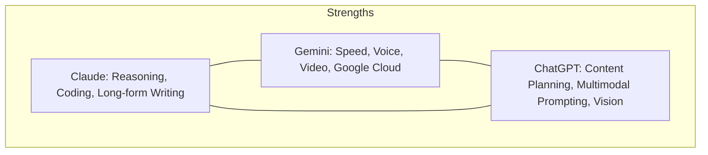

# 🔱 The Golden Triangle: Triple Model Strategy (2026)

**The Power of Three: Claude + Gemini + ChatGPT**  
Jab ye teeno milte hain, tab banti hai ek **Absolute Content Machine**. Har model ki apni ek super-power hai.

---

## 🏛️ The Three Pillars

### 1. 🧠 Claude (The Lead Researcher)
*   **Role**: Deep analysis, complex coding, and structured reporting.
*   **Best for**: Reading 100-page arXiv papers, writing technical documentation, and complex logic.
*   **Mission Control**: Use Claude to build the *logic* of your system.

### 2. ⚡ Gemini (The Reality Engine)
*   **Role**: Action and real-time integration.
*   **Best for**: Voice conversations (VANI), Video generation (Veo), and Google Workspace (Gmail/Calendar).
*   **Mission Control**: Use Gemini to *execute* tasks and talk to the real world.

### 3. 🔥 ChatGPT (The Creative Spark)
*   **Role**: Brainstorming, prompt orchestration, and creative hooks.
*   **Best for**: Generating 10 different video script hooks, creating complex image/video prompts, and multimodal Vision tasks.
*   **Mission Control**: Use ChatGPT to *orchestrate* the creative flow.

---

## 🚀 The Integration Workflow

### Scenario: Creating a Cinematic Video in 60 Minutes

1.  **Research (Claude)**: Paste the Lyra 2.0 paper. Ask Claude for a 2-page deep dive summary and technical accuracy check.
2.  **Scripting (ChatGPT)**: Give Claude's summary to ChatGPT. Ask it to write a 10-scene "dramatic" Hindi script for YouTube with hook-heavy narration.
3.  **Prompts (ChatGPT)**: Ask ChatGPT to generate 20 cinematic prompts for Hailuo/Kling based on the script.
4.  **Voice & Production (Gemini)**: Use Gemini to convert the final script into a high-fidelity voice (VANI) and handle the file organization via Google Drive.

---

## 💼 Business Use Cases (Triple-Threat)

| Product | Claude's Job | Gemini's Job | ChatGPT's Job |
| :--- | :--- | :--- | :--- |
| **AI Agency** | Contract & Code Logic | Voice Support & Video | Ads & Social Strategy |
| **EdTech** | Deep Lesson Planning | Instant Tutoring (Live) | Creative Quizzes & Visuals|
| **SaaS** | Backend System Design | Real-time Dashboard Data | UI/UX Copy & Marketing |

---

## 💰 The Revenue Engine
By combining these three, you can charge **Premium Agency Fees** ($2000+/mo) because your output quality will be 10x better than people using just one model.

**Next Steps:**
- [ ] Set `OPENAI_API_KEY` in `.env`.
- [ ] Connect `backend_main.py` to OpenAI.
- [ ] Start the 100CR Content Engine.
